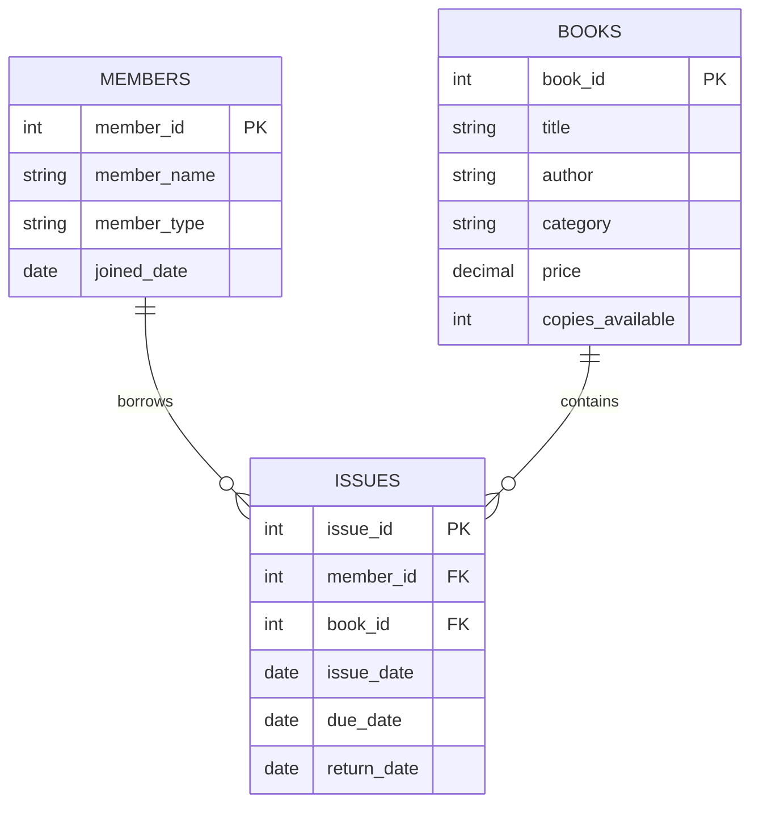

# Library Management System

## Project Overview
The Library Management System is a SQL-based mini project developed using MySQL. It helps manage library books, members, book issuing and returning records.

## Technologies Used
- MySQL
- SQL
- GitHub

## Database Name
librarydb

## Tables Used

1. Members
2. Books
3. Issues

## Table Description

### 1. Members
Stores member details.
- member_id
- member_name
- member_type
- joined_date

### 2. Books
Stores book information.
- book_id
- title
- author
- category
- price
- copies_available

### 3. Issues
Stores book issuing and returning details.
- issue_id
- member_id
- book_id
- issue_date
- due_date
- return_date

## ER Diagram

## Project Features

1. Create database and tables.
2. Insert members and books.
3. Manage book issue records.
4. Display all records.
5. Count total members and books.
6. Find top 5 borrowed books.
7. Identify members who never borrowed books.
8. Display currently issued books.
9. Calculate late return fines.
10. Rank members based on borrowing.
11. Find popular book categories.
12. Use stored procedures.
13. Use database triggers.

## Fine Calculation

Fine = Late Days × ₹2

## SQL Concepts Used

- CREATE DATABASE
- CREATE TABLE
- INSERT
- SELECT
- UPDATE
- JOIN
- GROUP BY
- ORDER BY
- COUNT
- DATEDIFF
- RANK
- STORED PROCEDURE
- TRIGGER
- FOREIGN KEY

## How to Run

1. Open MySQL Workbench.
2. Open the library_management.sql file.
3. Execute the SQL code.
4. Select the librarydb database.
5. Run SELECT queries to view the output.

## Expected Records

| Table | Records |
|---|---:|
| Members | 12 |
| Books | 15 |
| Issues | 32 |

## Conclusion

The Library Management System makes library work easier by maintaining book details, member information and issue records. It reduces manual work and helps calculate fines and generate reports.

## Project Type
BCA Mini Project

## Author
shree
# Sag11
library management system 
